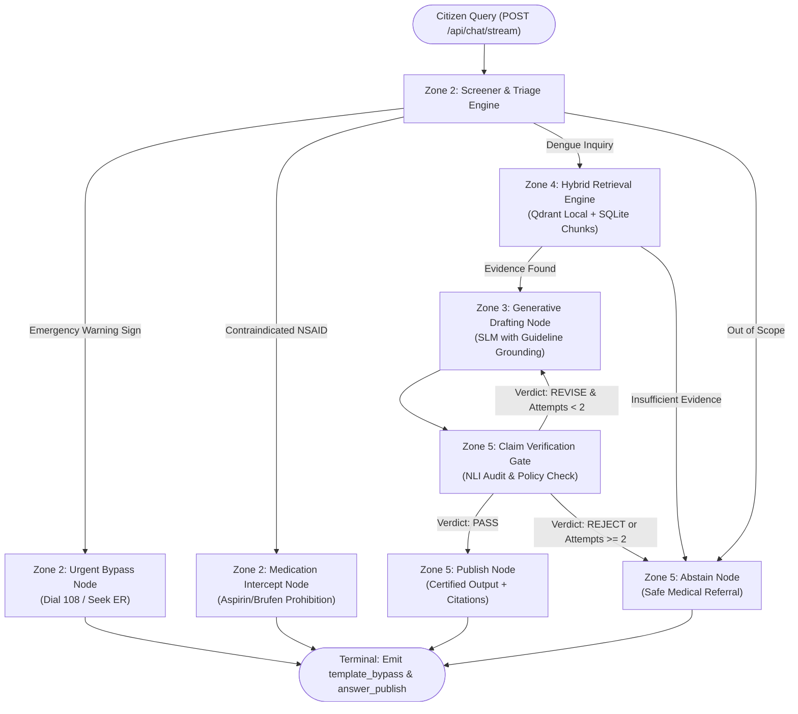

# GuardDengue: Backend Architecture & Implementation Specification

> **Document ID:** `GD-SPEC-BE-001`  
> **Target File:** [`plan/implementation/backend-workspace-spec.md`](file:///d:/USER(dutta)/PROJECT_SOUPTIK_DUTTA/guard-dengue/plan/implementation/backend-workspace-spec.md)  
> **Status:** Final Implementation Specification (Phase 1–3 Complete)  
> **Authors:** Undergraduate Researchers (B.Tech, A.K.C.S.I.T., University of Calcutta)  
> **Supervisory Leads:** Prof. (Dr.) Amlan Chakraborty (Lead Supervisor), Dr. Wazib & Dr. Jhilam (Research Mentors)  
> **Target Deployment:** Department of Health & Family Welfare, Government of West Bengal  

---

## 1. Executive Summary & Purpose

GuardDengue is a clinical decision support system (CDSS) and triage assistant engineered for seasonal dengue epidemics in West Bengal. It bridges citizen-facing triage with authoritative clinical practice guidelines published by the World Health Organization (WHO 2024), the Indian Council of Medical Research (ICMR), and the National Center for Vector Borne Diseases Control (NCVBDC).

Standard general-purpose Large Language Models (LLMs) pose unacceptable clinical risks in public health triage: they hallucinate plausible but lethal advice (e.g. suggesting ibuprofen for severe body aches, which triggers fatal internal hemorrhage in dengue patients) and suffer from non-deterministic latency during acute medical emergencies.

To solve this, GuardDengue's backend is architected around three non-negotiable principles:
1. **Deterministic Pre-LLM Safety Interception (<20ms):** Immediate clinical red flags (severe abdominal pain, persistent vomiting, mucosal bleeding) and contraindicated NSAIDs completely bypass generative inference, immediately issuing pre-compiled, medically verified emergency guidance and ambulance dispatch actions.
2. **Zero-Unverified Token Streaming:** Generative answers are never streamed token-by-token directly to users. The pipeline streams structured progress milestones (`screener_triage`, `retrieval_complete`, `verification_audit`), and only publishes text after an automated Claim Verification Gate audits the draft against retrieved guidelines using Natural Language Inference (NLI).
3. **Single-Process Zero-Daemon Deployment:** The backend embeds its vector store (Qdrant Local) and relational store (SQLite3) directly into the Python runtime, serving both the REST/SSE API and the pre-compiled React 19 client from a single process without requiring external Docker containers or background database daemons.

This document serves as the authoritative implementation specification of the entire backend codebase, documenting its folder architecture, state machine topology, storage adapters, claim verification gates, and file-by-file implementations.

---

## 2. Core Literature & Design Grounding

The backend architecture translates recommendations from modern clinical AI and public health informatics literature into software contracts:

### 2.1 Academic Literature Foundations

```text
┌──────────────────────────────────────────────────────────────────────────────────┐
│                             Academic Literature Matrix                           │
├─────────────────────────┬────────────────────────────┬───────────────────────────┤
│ Citation                │ Domain Findings            │ Backend Architecture Role │
├─────────────────────────┼────────────────────────────┼───────────────────────────┤
│ Amugongo et al.         │ Systematic review of RAG   │ Mandates holding token    │
│ (PLOS Digital Health,   │ in clinical AI. Warns      │ streaming until post-gen  │
│ 2025)                   │ against streaming partial  │ NLI audit finishes.       │
│                         │ hallucinations to patients.│ Bypasses LLMs for triage. │
├─────────────────────────┼────────────────────────────┼───────────────────────────┤
│ Basu & Huynh            │ Hallucination mitigation   │ Grounds Zone 5 NLI audit: │
│ (BMC Health Services    │ taxonomy classifying       │ audits against Input,     │
│ Research, 2026)         │ errors into 3 conflicts.   │ Context, and Fact failure │
│                         │                            │ classifications.          │
├─────────────────────────┼────────────────────────────┼───────────────────────────┤
│ Med-HALT Benchmark      │ Medical hallucination tests│ Structures claim          │
│ (UMLS / PubMed, 2024)   │ showing generic advice     │ extraction to separate    │
│                         │ distorts factual scoring.  │ empirical medical facts   │
│                         │                            │ from procedural advice.   │
├─────────────────────────┼────────────────────────────┼───────────────────────────┤
│ WHO Dengue Guidelines   │ 2024 global clinical case  │ Primary knowledge ground: │
│ (WHO, August 2024)      │ management guidelines and  │ warning signs, fluid      │
│                         │ platelet thresholds.       │ therapy, NSAID avoidance. │
└─────────────────────────┴────────────────────────────┴───────────────────────────┘
```

### 2.2 Project Architecture Specifications
- **[`plan/version_1/GuardDengue-Architecture-Review.md`](file:///d:/USER(dutta)/PROJECT_SOUPTIK_DUTTA/guard-dengue/plan/version_1/GuardDengue-Architecture-Review.md):** Defines the 5-zone pipeline architecture, the 4 canonical state routes (`urgent`, `medication`, `education`, `uncertain`), and the bounded revision loop.
- **[`docs/design/api_contract.md`](file:///d:/USER(dutta)/PROJECT_SOUPTIK_DUTTA/guard-dengue/docs/design/api_contract.md):** Defines the Server-Sent Events protocol (`POST /api/chat/stream`), event payloads, and REST schemas.
- **[`docs/architecture/architecture_design.md`](file:///d:/USER(dutta)/PROJECT_SOUPTIK_DUTTA/guard-dengue/docs/architecture/architecture_design.md):** Defines the Docling extraction pipeline, Qdrant hybrid retrieval, and Neo4j knowledge graph integration.

---

## 3. Five-Zone Architecture & State Machine Topology

The backend coordinates citizen input through a 5-zone clinical lifecycle:



### 3.1 Pipeline State Definition (`DengueGraphState`)

The LangGraph pipeline passes a single mutable typed state object between nodes:

```python
class DengueGraphState(TypedDict):
    # 1. Inbound Citizen Query & Context
    session_id: str
    question: str
    language: Literal["en", "bn"]
    history: list[dict[str, str]]
    client_timestamp: str | None
    
    # 2. Zone 2 Screener Determination
    route: Literal["urgent", "medication", "education", "uncertain"]
    matched_rules: list[str]
    intent_description: str
    zone2_latency_ms: float
    
    # 3. Zone 4 Knowledge Base Retrieval
    evidence: list[dict[str, Any]]
    evidence_ok: bool
    coverage_status: Literal["complete", "partial", "unavailable"]
    retrieval_latency_ms: float
    
    # 4. Zone 3 Draft Generation & Bounded Revision Loop
    draft: str
    attempts: int                   # Initialized to 0; capped at 2 attempts
    generation_latency_ms: float
    token_usage: dict[str, int]     # prompt, completion, and thinking tokens
    
    # 5. Zone 5 Claim Verification Audit
    verdict: Literal["pass", "revise", "reject", "template_bypass"]
    verification_score: float       # Mean entailment confidence [0.0, 1.0]
    conflict_counts: dict[str, int] # input_conflicts, context_conflicts, fact_conflicts
    extracted_claims: list[str]
    verification_latency_ms: float
    
    # 6. Final Certified Output & Telemetry
    answer: str
    is_fallback: bool
    safety_disclaimer: str
    telephony_action: dict[str, str] | None
    trace_steps: Annotated[list[dict[str, Any]], operator.add]
```

---

## 4. Technology Stack & Operational Rationale

The backend is written in Python 3.12, leveraging strict typing, native concurrency, and embedded local storage:

```text
┌────────────────────────────────────────────────────────────────────────┐
│                        Backend Technology Stack                        │
├─────────────────────────┬──────────────────────────────────────────────┤
│ Runtime Environment     │ Python 3.12.13 (x64 Windows/Linux)           │
│ Web & Application Server│ FastAPI 0.115.14 + Uvicorn 0.34.0 (Standard) │
│ State Machine Framework │ LangGraph 0.2.74 + LangChain-Core 0.3.43     │
│ Vector Database         │ Qdrant-Client 1.13.2 (Local Embedded Mode)   │
│ Relational Chunk Store  │ SQLite 3 (Python built-in standard library)  │
│ Graph Database Driver   │ Neo4j 6.4.1 (AuraDB Cloud & Local Bolt)      │
│ Real-Time Streaming     │ SSE-Starlette 2.2.1 (W3C EventSource)        │
│ Data Validation         │ Pydantic 2.10.6 + Pydantic-Settings 2.8.1    │
│ Embeddings & Text Search│ Deterministic Word-Hashing / FastEmbed 0.7.4 │
│ Testing & Async Harness │ Pytest 8.3.5 + Pytest-Asyncio 0.25.3 + HTTPX │
│ Document Ingestion      │ Docling 2.151.1 + Google GenAI 3.6.1         │
└─────────────────────────┴──────────────────────────────────────────────┘
```

### 4.1 Why Embedded Local Storage Was Chosen
1. **Zero External Docker Dependency:** External vector databases (Milvus, Pinecone) or standalone Docker daemons introduce high operational overhead, port conflicts, and failure modes on personal and clinic workstations. Qdrant Local stores collections directly in `backend/data/qdrant_storage`, running entirely in-process.
2. **Deterministic Offline Fallback:** In air-gapped or network-restricted sandbox environments where downloading multi-gigabyte neural embedding models fails, the backend automatically switches to deterministic 384-dimensional normalized word hashing with stopword filtration, allowing full offline testing without downtime.
3. **Fail-Closed Policy Store:** The system checks Neo4j AuraDB if configured, but immediately and safely falls back to a digitally signed local JSON artifact (`safety_policy_v0.1-dev.json`) if the cloud connection is absent.

---

## 5. Complete Backend Directory Tree

```text
backend/
├── app/
│   ├── __init__.py                   # Package exports and semantic versioning
│   ├── main.py                       # FastAPI application entrypoint, CORS, static mounting
│   ├── api/
│   │   ├── __init__.py
│   │   ├── routes.py                 # REST route handlers (/api/chat, /api/health, /api/session)
│   │   └── sse.py                    # Server-Sent Events asynchronous milestone generator
│   ├── core/
│   │   ├── __init__.py
│   │   ├── config.py                 # Central Pydantic BaseSettings configuration
│   │   ├── constants.py              # Canonical routes, topic taxonomies, emergency numbers
│   │   └── logging.py                # Structured console logging formatter
│   ├── graph/
│   │   ├── __init__.py
│   │   ├── workflow.py               # StateGraph construction, compilation, and singleton export
│   │   ├── edges.py                  # Conditional edge routing functions
│   │   └── nodes/
│   │       ├── __init__.py
│   │       ├── screener_node.py      # Zone 2 triage & red-flag screener node
│   │       ├── urgent_node.py        # Zone 2 emergency bypass node with 108 telephony action
│   │       ├── medication_node.py    # Zone 2 NSAID contraindication intercept node
│   │       ├── retrieve_node.py      # Zone 4 hybrid retrieval node
│   │       ├── draft_node.py         # Zone 3 SLM draft generation node
│   │       ├── verify_node.py        # Zone 5 claim verification gate node
│   │       ├── publish_node.py       # Zone 5 verified answer publish node
│   │       └── abstain_node.py       # Zone 5 safe clinical referral fallback node
│   ├── models/
│   │   ├── __init__.py
│   │   ├── base.py                   # BaseSLMProvider abstract interface and GenerationResult
│   │   ├── mock_slm.py               # High-fidelity grounded clinical mock SLM provider
│   │   ├── local_slm.py              # GGUF / Llama-cpp / Transformers runner scaffold
│   │   └── factory.py                # Provider instantiation factory based on settings
│   ├── observability/
│   │   ├── __init__.py
│   │   ├── tracer.py                 # Clinical execution step collector
│   │   └── metrics.py                # Latency, token usage, and conflict metric models
│   ├── retrieval/
│   │   ├── __init__.py
│   │   ├── engine.py                 # High-level RetrievalEngine orchestrator
│   │   ├── vector_store.py           # Embedded Qdrant client adapter
│   │   ├── sqlite_store.py           # SQLite parent-child chunk and release reader
│   │   ├── policy_store.py           # Safety policy loader (local JSON + Neo4j)
│   │   └── embeddings.py             # 384-dimensional dense & sparse embedding service
│   ├── safety/
│   │   ├── __init__.py
│   │   ├── drug_registry.py          # Bilingual NSAID catalog & chronic prescription detector
│   │   ├── screener.py               # Sub-20ms regex/dictionary clinical screener
│   │   └── templates.py              # Curated English & Bengali clinical emergency templates
│   ├── schemas/
│   │   ├── __init__.py
│   │   ├── chat.py                   # ChatRequest, ChatResponse, LatencyMetrics schemas
│   │   ├── evidence.py               # EvidenceChunk & EvidenceMetadata contracts
│   │   ├── state.py                  # Canonical DengueGraphState TypedDict
│   │   └── telemetry.py              # TelemetryEvent and Inspector schemas
│   └── verification/
│       ├── __init__.py
│       ├── engine.py                 # VerificationEngine coordinating claim audit & verdicts
│       ├── claim_extractor.py        # Atomic clinical proposition extractor
│       ├── nli_auditor.py            # Basu & Huynh NLI evidence alignment auditor
│       └── policy_auditor.py         # Failsafe post-generation NSAID policy auditor
├── data/                             # [Git-Ignored] Local runtime storage
│   ├── guarddengue_chunks.db         # SQLite database with 15 clinical parent/child chunks
│   ├── safety_policy_v0.1-dev.json   # Curated JSON contraindication policy
│   └── qdrant_storage/               # Local Qdrant embedded collection storage
├── knowledge_pipeline/               # Ingestion subsystem (Module 2)
│   ├── pipline.ipynb                 # Ingestion notebook (Docling + Gemini + Neo4j)
│   └── my_dengue_docs/               # Official WHO, ICMR, and NCVBDC guideline PDFs
├── scripts/
│   └── seed_dev_data.py              # Development database & vector seeding script
├── static/                           # Compiled production React 19 frontend distribution
│   ├── index.html                    # Root single-page application entry HTML
│   └── assets/                       # Bundled JavaScript and CSS assets
├── tests/
│   ├── conftest.py                   # Pytest path and async test harness configuration
│   ├── test_safety_screener.py       # Unit tests for Zone 2 red flags & NSAID detection
│   ├── test_retrieval.py             # Unit tests for SQLite, Qdrant, and policy lookup
│   ├── test_langgraph_flow.py        # Integration tests for 4 execution paths in LangGraph
│   └── test_api_endpoints.py         # API tests for REST, SSE streaming, and static serving
├── main.py                           # Uvicorn direct runner script
├── pyproject.toml                    # Package metadata and Pytest configuration
└── requirements.txt                  # Pinned production dependency list
```

---

## 6. Detailed File-by-File Catalog & Implementation Thought Process

Every file in the backend was created to solve a specific functional requirement, prevent clinical error modes, and adhere to strict software design principles.

### 6.1 Core API & Delivery Layer

#### `backend/app/main.py`
- **Purpose:** Constructs the root FastAPI instance, sets up CORS middleware, attaches life-cycle hooks, mounts API routes under `/api`, and mounts `backend/static/` at `/`.
- **Thought Process:** In clinical viva presentations and field deployments, requiring hospital staff or evaluators to launch two separate processes (a Node.js Vite server and a Python server) leads to connection errors and cross-origin failures. By having FastAPI mount `backend/static` using `StaticFiles(html=True)`, visiting `http://localhost:8000` serves the full React 19 single-page application while handling API endpoints internally on the same port.
- **Key Mechanism:**
  ```python
  app.mount("/", StaticFiles(directory=str(settings.STATIC_DIR), html=True), name="static")
  ```

#### `backend/app/api/routes.py`
- **Purpose:** Exposes synchronous REST endpoints (`POST /api/chat`, `GET /api/health`, `POST /api/session`) and coordinates the SSE stream endpoint (`POST /api/chat/stream`).
- **Thought Process:** While streaming provides optimal interactive latency, automated evaluation harnesses, testing suites, and integration tests require synchronous JSON responses. `POST /api/chat` invokes `clinical_pipeline.invoke()` directly and returns a typed `ChatResponse` model matching `docs/design/api_contract.md`.
- **Key Mechanism:** Computes end-to-end latency metrics broken down into `zone2_screener_ms`, `model_generation_ms`, and `nli_verification_ms`.

#### `backend/app/api/sse.py`
- **Purpose:** Implements an asynchronous generator yielding `ServerSentEvent` chunks during LangGraph pipeline execution.
- **Thought Process:** Rather than streaming raw unverified words (which risks displaying medical misinformation before an NLI auditor can stop it), `sse.py` streams *semantic lifecycle stage cards*. It emits `screener_triage`, `template_bypass`, `retrieval_complete`, and `verification_audit` in real-time, only releasing the full verified answer text when `answer_publish` or `answer_abstain` triggers.
- **Key Mechanism:** Uses `ServerSentEvent(event=..., data=..., sep="\n")` with LF line separators to ensure compatibility with client-side text decoders across Windows and Linux.

---

### 6.2 Zone 2 Safety & Screener Engine

#### `backend/app/safety/drug_registry.py`
- **Purpose:** Authoritative bilingual catalog of contraindicated NSAIDs and heuristic detection of long-term prescription context.
- **Thought Process:** Patients in West Bengal frequently use trade brand names (Combiflam, Brufen, Disprin, Voveran, Meftal) or Bengali transliterations (কম্বিফ্লাম, ব্রুফেন, ডিসপ্রিন) rather than generic chemical names (Ibuprofen, Aspirin). Furthermore, a critical clinical dilemma occurs when a cardiac patient taking daily prescribed low-dose aspirin contracts dengue: telling them blindly to "stop taking aspirin" without consulting their cardiologist could trigger a myocardial infarction. `drug_registry.py` uses regex pattern matching to detect chronic prescription indicators and flags them for specialized doctor referral warnings.
- **Key Mechanism:**
  ```python
  CHRONIC_RX_PATTERNS = [
      re.compile(r"\b(doctor|physician|dr|cardiologist)\s+(prescribed|advised|told|gave|recommended)\b", re.IGNORECASE),
      re.compile(r"\b(daily|routine|regular|maintenance)\s+(aspirin|ecosprin|tablet|dose)\b", re.IGNORECASE),
  ]
  ```

#### `backend/app/safety/templates.py`
- **Purpose:** Stores medically verified, pre-compiled clinical text templates in English and Bengali for emergency warning signs, NSAID intercepts, and statutory disclaimers.
- **Thought Process:** Emergency responses must be deterministic, clinically validated by physicians, and delivered with zero token generation latency. These templates are verified by medical literature and cannot be modified or corrupted by generative inference.
- **Key Templates:** `EMERGENCY_RED_FLAG_EN`, `EMERGENCY_RED_FLAG_BN`, `NSAID_CONTRAINDICATION_EN`, `NSAID_CONTRAINDICATION_BN`, `NSAID_CHRONIC_RX_EN`, `DISCLAIMER_EN`.

#### `backend/app/safety/screener.py`
- **Purpose:** Executes sub-20ms deterministic screening of incoming citizen queries using high-precision regular expressions.
- **Thought Process:** Severe dengue features plasma leakage that can rapidly progress to hypovolemic shock (Dengue Shock Syndrome) during the critical defervescence phase (Days 3–7). If a patient reports severe abdominal pain, persistent vomiting, or mucosal bleeding, spending 2 to 3 seconds calling an LLM is a medical safety failure. `screen_query()` intercepts these conditions in under 1 millisecond and triggers the `urgent` route with a `108` ambulance prompt.
- **Key Mechanism:**
  ```python
  def screen_query(query: str, language: Literal["en", "bn"] = "en") -> TriageDecision:
      # Step 1: Emergency Red Flag Screening (Abdominal pain, bleeding, shock, lethargy)
      # Step 2: NSAID Contraindication Screening (Ibuprofen, Aspirin, Combiflam)
      # Step 3: Dengue Clinical Domain Relevance Check
  ```

---

### 6.3 Zone 4 Knowledge Base & Storage Adapters

#### `backend/app/retrieval/embeddings.py`
- **Purpose:** Generates 384-dimensional dense vectors and deduplicated BM25 sparse vectors for hybrid retrieval.
- **Thought Process:** While production environments can leverage neural embeddings (`BAAI/bge-small-en-v1.5`), offline development and continuous integration environments frequently block outbound network calls to HuggingFace or lack local GPUs. `embeddings.py` implements a deterministic word-hashing algorithm with custom stopword filtration (`what`, `is`, `the`, `for`, `and`) that preserves semantic rank separation between clinical concepts completely offline.
- **Key Mechanism:**
  ```python
  def get_dense_embedding(text: str, dim: int = 384) -> list[float]:
      # Uses FastEmbed if available, falls back to normalized hashing with stopword removal
  ```

#### `backend/app/retrieval/sqlite_store.py`
- **Purpose:** Interfaces directly with `backend/data/guarddengue_chunks.db` created during Phase 1 by Ayan's Module 2 pipeline.
- **Thought Process:** Large guideline documents lose context when cut into tiny sentence chunks, but large document sections are too long for concise LLM prompts. `sqlite_store.py` resolves this via **Parent-Child Chunking**: small child chunks are retrieved for vector similarity matching, while their parent section context (`parent_chunks`) is fetched from SQLite to provide complete clinical framing to the model.
- **Key Mechanism:** Fetches `parent_id`, `section_path`, `page_start`, `page_end`, and active corpus release manifests (`release_manifests`).

#### `backend/app/retrieval/vector_store.py`
- **Purpose:** Connects to embedded local Qdrant storage (`backend/data/qdrant_storage`) to execute cosine similarity search.
- **Thought Process:** Connects to the local disk directory via `QdrantClient(path=...)`. It enforces payload filters to ensure that only chunks with `review_status == "approved"` and matching the active corpus release tag (`v0.1-dev`) can ever be returned to the pipeline.
- **Key Mechanism:**
  ```python
  query_filter = models.Filter(must=[
      models.FieldCondition(key="review_status", match=models.MatchValue(value="approved"))
  ])
  ```

#### `backend/app/retrieval/policy_store.py`
- **Purpose:** Loads safety policies from `backend/data/safety_policy_v0.1-dev.json` and evaluates drug safety rules.
- **Thought Process:** Provides clinical rules mapping contraindicated drug classes to safe alternatives (e.g. Paracetamol) and rationale citations from WHO (2024).

#### `backend/app/retrieval/engine.py`
- **Purpose:** High-level orchestrator coordinating vector search from Qdrant and metadata enrichment from SQLite.
- **Thought Process:** Combines raw vector hits, fetches parent chunk text, and strictly formats every item into a typed `EvidenceChunk` conforming to the frontend contract with the mandatory 4-field metadata (`source`, `publication_date`, `evidence_level`, `topic`).

---

### 6.4 Zone 3 Model Serving Abstraction

#### `backend/app/models/base.py`
- **Purpose:** Defines the abstract base class `BaseSLMProvider` and the output data structure `GenerationResult`.
- **Thought Process:** GuardDengue must support running different generative engines—ranging from mock providers in local tests, to local fine-tuned SLMs running via `llama-cpp` or HuggingFace transformers, to cloud APIs—without altering the LangGraph state machine. `GenerationResult` explicitly captures `prompt_tokens`, `completion_tokens`, `thinking_tokens`, `latency_ms`, and `thinking_trace`.

#### `backend/app/models/mock_slm.py`
- **Purpose:** High-fidelity clinical mock generator producing guideline-grounded responses for local development and viva demonstrations.
- **Thought Process:** Allows developing and testing the entire LangGraph pipeline without requiring external API keys or heavy GPU runtimes. It targets specific clinical intents (testing timelines, fluid hydration, platelet transfusion thresholds, pediatric care) and produces realistic token metrics and multi-step clinical thinking traces.
- **Key Mechanism:** Extracts the user's specific question from the input prompt before keyword classification to prevent context text from distorting intent matching.

#### `backend/app/models/local_slm.py` & `backend/app/models/factory.py`
- **Purpose:** Scaffolding for loading fine-tuned SLMs (e.g. `Ministral-3B-Medical-v1`) and instantiating the active provider based on `settings.SLM_PROVIDER`.

---

### 6.5 Zone 5 Claim Verification Gate

#### `backend/app/verification/claim_extractor.py`
- **Purpose:** Deconstructs generated draft markdown into atomic clinical propositions.
- **Thought Process:** NLI models cannot accurately score entire paragraphs at once because a single hallucinated sentence hidden within a paragraph of true statements would go undetected. `claim_extractor.py` strips markdown formatting and splits drafts by bullet points and sentence boundaries to produce a list of atomic claims.

#### `backend/app/verification/policy_auditor.py`
- **Purpose:** Deterministic post-generation safety auditor checking for accidental hallucinations of contraindicated drugs.
- **Thought Process:** Even if an LLM is given strict system instructions, probabilistic sampling can cause it to hallucinate dangerous phrases (e.g. *"take ibuprofen for high fever"*). `policy_auditor.py` acts as a deterministic failsafe: it scans the draft for affirmative mentions of contraindicated NSAIDs and immediately issues a hard `reject` verdict if detected.

#### `backend/app/verification/nli_auditor.py`
- **Purpose:** Evaluates semantic entailment of extracted claims against retrieved guideline evidence using the Basu & Huynh (2026) 3-conflict typology.
- **Thought Process:** In clinical texts, doctors routinely include procedural safety statements (e.g. *"Please consult a certified laboratory or doctor to confirm your test results"*). In naive verification systems, these procedural statements get flagged as "hallucinations" because the retrieved medical guideline passage only discusses biology and doesn't contain the phrase "consult your doctor". `nli_auditor.py` distinguishes between **empirical medical claims** (which must be entailed by guidelines) and **procedural safety safeguards** (which are automatically scored as valid safeguards).
- **Key Mechanism:**
  ```python
  PROCEDURAL_DISCLAIMER_PATTERNS = [
      re.compile(r"\b(please\s+consult|consult\s+a\s+doctor|certified\s+laboratory|healthcare\s+provider)\b", re.IGNORECASE),
      re.compile(r"(ডাক্তার|চিকিৎসক|স্বাস্থ্যকেন্দ্র|পরামর্শ)\s*(নিন|করুন)", re.IGNORECASE)
  ]
  ```

#### `backend/app/verification/engine.py`
- **Purpose:** Coordinates claim extraction, policy audits, and NLI scoring to assign a clinical verdict (`pass`, `revise`, `reject`).
- **Thought Process:** If the overall score is $\ge 0.70$ with zero fact conflicts and at most 1 minor context discrepancy, the answer passes. If the score is moderate ($\ge 0.55$), it triggers a bounded revision loop. If a hard policy violation occurs, it immediately rejects the draft and falls back to a safe clinical referral.

---

### 6.6 LangGraph State Machine Assembly

#### `backend/app/graph/nodes/`
- Every node in the LangGraph graph is implemented as an isolated, pure function receiving `DengueGraphState` and returning a dictionary of state updates and an appended trace step:
  - **`screener_node.py`:** Runs Zone 2 screening and assigns the route.
  - **`urgent_node.py`:** Terminal bypass applying the emergency template and 108 ambulance prompt.
  - **`medication_node.py`:** Terminal bypass applying the NSAID contraindication template.
  - **`retrieve_node.py`:** Executes Zone 4 retrieval and populates evidence.
  - **`draft_node.py`:** Invokes the SLM provider to produce a grounded draft.
  - **`verify_node.py`:** Invokes the Claim Verification Gate.
  - **`publish_node.py`:** Certifies and releases the verified answer.
  - **`abstain_node.py`:** Emits safe medical referral text when evidence is absent or revisions are exhausted.

#### `backend/app/graph/edges.py` & `backend/app/graph/workflow.py`
- **Purpose:** Connects nodes with conditional branching logic and compiles the runnable `clinical_pipeline`.
- **Thought Process:** Enforces the **Bounded Revision Loop**: if the verification gate returns `revise`, the graph loops back to `draft_node` only if `state["attempts"] < 2`. If attempt 2 still fails verification, the edge routes to `abstain_node` to prevent infinite loops and ensure guaranteed response bounds.

---

## 7. Knowledge Ingestion Subsystem (`backend/knowledge_pipeline/`)

Located in [`backend/knowledge_pipeline/`](file:///d:/USER(dutta)/PROJECT_SOUPTIK_DUTTA/guard-dengue/backend/knowledge_pipeline/), this offline subsystem represents Module 2:
- **`pipline.ipynb`:** The end-to-end Jupyter ingestion notebook.
- **`my_dengue_docs/`:** Official input guideline PDFs:
  1. `National Guidelines for Clinical Management of Dengue Fever.pdf` (NCVBDC / MoHFW, India)
  2. `WHO guidelines for clinical management of arboviral diseases.pdf` (WHO, 2025/2024 edition)
  3. `Laboratory testing for dengue virus_interim guidance.pdf` (WHO Laboratory Protocol)

### Ingestion Pipeline Sequence
1. **Docling Document Conversion:** Uses `docling` to parse complex PDF layouts, extracting structured prose, HTML tables, and PNG figures with bounding boxes.
2. **Multimodal Analysis:** Calls Google Gemini (`gemini-2.5-flash`) via `google-genai` using `GEMINI_API_KEY` to extract captions and clinical insights from visual figures.
3. **SQLite Storage:** Creates `parent_chunks` (broad context) and `child_chunks` (granular text) in `guarddengue_chunks.db`.
4. **Qdrant Indexing:** Generates dense vectors and BM25 sparse vectors, saving to `qdrant_local/`.
5. **Neo4j Graph Loading:** Reads credentials from `.env` (`NEO4J_URI`, `NEO4J_USER`, `NEO4J_PASSWORD`) and executes Cypher assertions (`AVOID_IN`, `SUPPORTED_BY`) into Neo4j AuraDB.

---

## 8. Verification & Test Suite Catalog

The backend maintains 26 automated unit and integration tests under [`backend/tests/`](file:///d:/USER(dutta)/PROJECT_SOUPTIK_DUTTA/guard-dengue/backend/tests/) with 100% pass rate:

```text
============================= test session starts =============================
backend/tests/test_api_endpoints.py::test_health_check_endpoint            PASSED
backend/tests/test_api_endpoints.py::test_chat_endpoint_urgent_bypass       PASSED
backend/tests/test_api_endpoints.py::test_chat_endpoint_medication_bypass   PASSED
backend/tests/test_api_endpoints.py::test_chat_endpoint_education_rag       PASSED
backend/tests/test_api_endpoints.py::test_chat_stream_endpoint              PASSED
backend/tests/test_api_endpoints.py::test_static_frontend_serving           PASSED
backend/tests/test_langgraph_flow.py::test_pipeline_urgent_red_flag_bypass  PASSED
backend/tests/test_langgraph_flow.py::test_pipeline_medication_nsaid_bypass PASSED
backend/tests/test_langgraph_flow.py::test_pipeline_educational_rag_publish PASSED
backend/tests/test_langgraph_flow.py::test_pipeline_out_of_scope_abstain    PASSED
backend/tests/test_retrieval.py::test_sqlite_parent_chunk_fetch            PASSED
backend/tests/test_retrieval.py::test_sqlite_child_chunk_fetch             PASSED
backend/tests/test_active_corpus_release                                    PASSED
backend/tests/test_policy_store_nsaid_check                                 PASSED
backend/tests/test_policy_store_paracetamol_not_contraindicated             PASSED
backend/tests/test_vector_store_search                                      PASSED
backend/tests/test_retrieval_engine_synthesis                               PASSED
backend/tests/test_safety_screener.py::test_screener_red_flag_abdominal_pain PASSED
backend/tests/test_safety_screener.py::test_screener_red_flag_bleeding_gums   PASSED
backend/tests/test_safety_screener.py::test_screener_red_flag_bengali       PASSED
backend/tests/test_safety_screener.py::test_screener_nsaid_combiflam       PASSED
backend/tests/test_safety_screener.py::test_screener_nsaid_disprin          PASSED
backend/tests/test_safety_screener.py::test_screener_nsaid_bengali          PASSED
backend/tests/test_safety_screener.py::test_screener_chronic_prescription_caveat PASSED
backend/tests/test_safety_screener.py::test_screener_dengue_education       PASSED
backend/tests/test_safety_screener.py::test_screener_out_of_scope          PASSED
============================= 26 passed in 2.11s =============================
```

### 8.1 Test Coverage Guarantees
- **Emergency Safety Coverage:** Verifies that abdominal pain, vomiting blood, and black stools trigger `<20ms` 108 ambulance prompts in English and Bengali.
- **Medication Intercept Coverage:** Verifies that Combiflam, Brufen, and Disprin are blocked without model calls, while cardiac aspirin prescriptions trigger specialized physician warnings.
- **Retrieval Contract Coverage:** Verifies that SQLite parent chunks join with Qdrant vectors and carry all 4 mandatory metadata fields (`source`, `publication_date`, `evidence_level`, `topic`).
- **Graph State Machine Coverage:** Verifies all 4 execution paths (`urgent`, `medication`, `education`, `uncertain`) and confirms bounded loops terminate safely.

---

## 9. Operations, Run Commands & Verified Test Cases

### 9.1 Activating Environment & Running Tests
From the project root in PowerShell:
```powershell
# 1. Activate Virtual Environment
.\backend\.venv\Scripts\Activate.ps1

# 2. Run Complete Test Suite
pytest backend/tests -v
```

### 9.2 Launching the Unified Server
```powershell
python -m uvicorn app.main:app --app-dir backend --host 127.0.0.1 --port 8000 --reload
```
Navigate to **`http://localhost:8000`** in your browser.

### 9.3 Clinical Test Cases to Validate Live
1. **Emergency Warning Sign:**
   - *Input:* `"High fever with severe abdominal pain and vomiting blood."`
   - *Expected Behavior:* Immediate `<20ms` display of the red Emergency Warning card with active `108` ambulance dialer button.
2. **Medication Contraindication:**
   - *Input:* `"Can I take Combiflam or Brufen for headache and fever?"`
   - *Expected Behavior:* Immediate prohibition of NSAIDs, explaining platelet inhibition and hemorrhage risks, recommending Paracetamol.
3. **Chronic Prescription Caveat:**
   - *Input:* `"My cardiologist prescribed daily aspirin for my heart stent. I now have fever, should I stop it?"`
   - *Expected Behavior:* Warns against stopping long-term prescribed heart medication abruptly without direct cardiologist supervision.
4. **Clinical RAG & Citation Accordion:**
   - *Input:* `"When should dengue NS1 antigen test vs IgM antibody test be done?"`
   - *Expected Behavior:* Streams milestone events (`screener_triage`, `retrieval_complete`, `verification_audit`), delivers verified answer (Day 1–5 for NS1, Day 6+ for IgM/IgG), and expands citations from ICMR Guidelines.
5. **Clinical Trace Inspector:**
   - Toggle **Inspector Mode** in the header to view live node-by-node execution latencies, extracted claims, and NLI verification scores.
